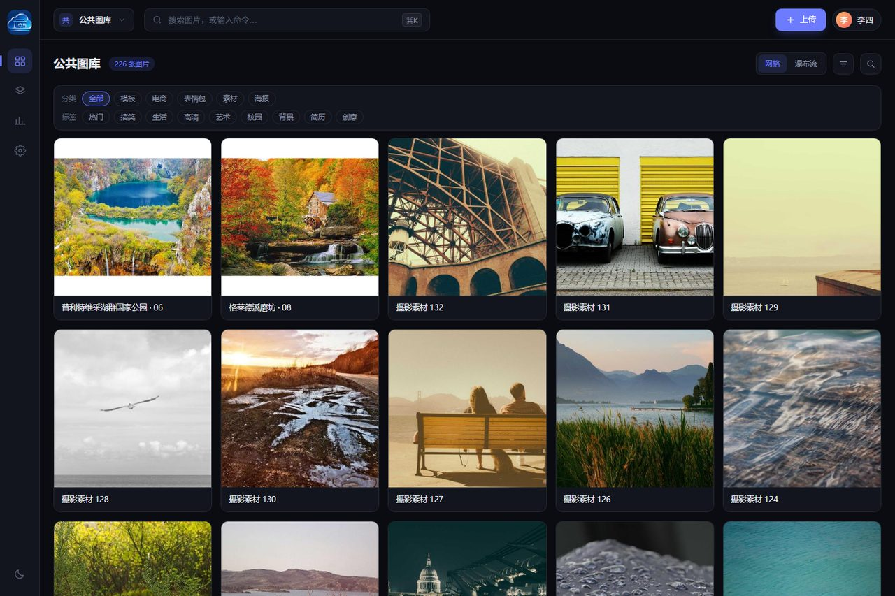
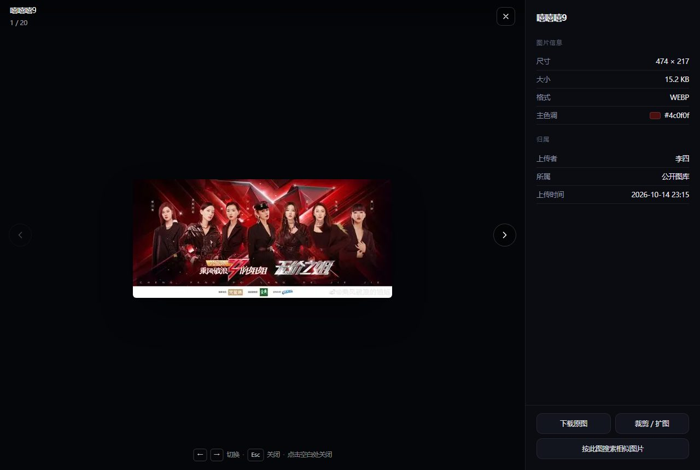
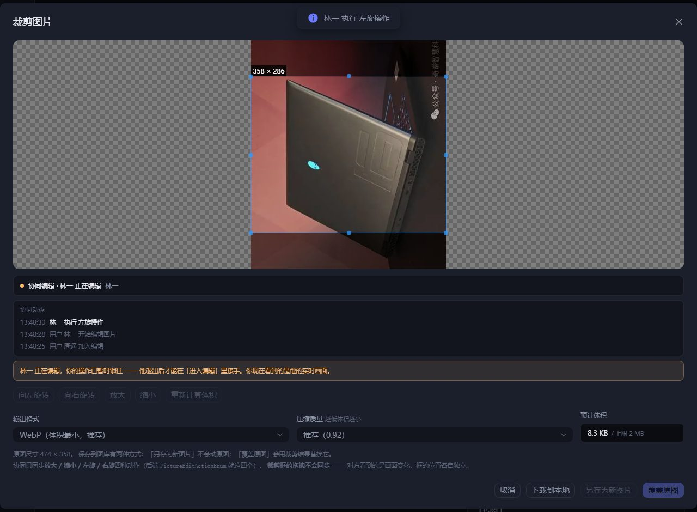
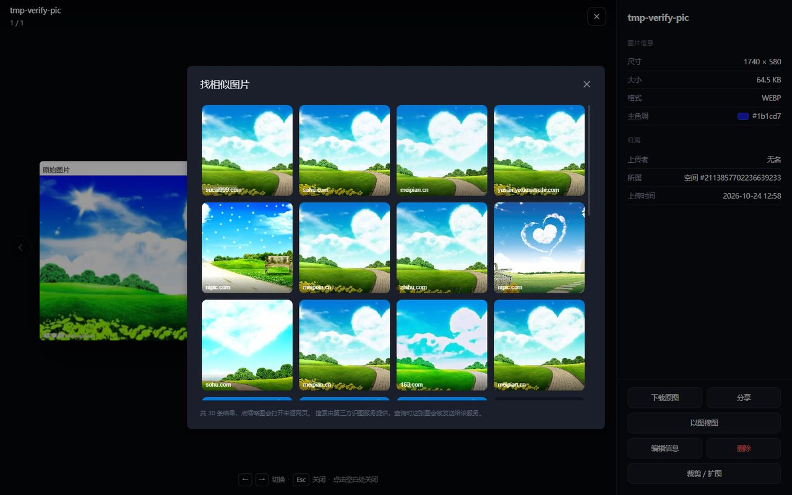
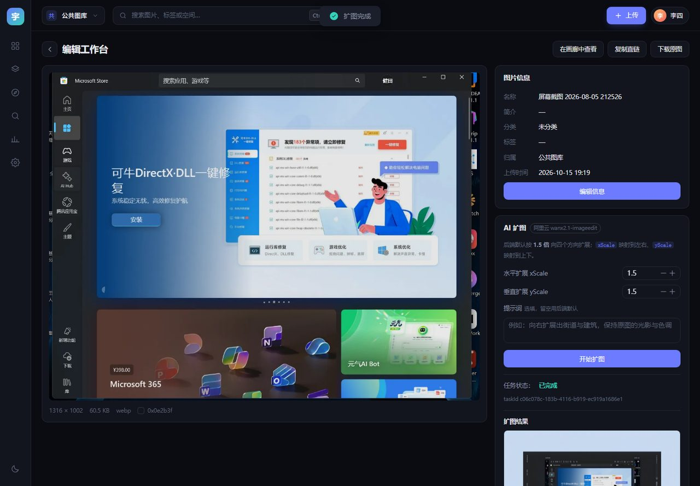

# 宇阁云图库 · YuGe Gallery

> 多空间视觉资产管理系统 —— 面向个人与团队，支持多空间隔离、多人实时协同编辑、AI 图像处理与对象存储。

配套后端：[yuge-picture-backend](https://github.com/bxzd1170/yuge-picture-backend)（Spring Boot 2.7.6 + MyBatis-Plus + Sa-Token + ShardingSphere）

在线体验：<http://39.104.13.97/> —— 未登录可直接浏览公共图库，登录后可使用空间与协同编辑

---

## 界面预览

| 公共图库 | 大图浏览 |
| --- | --- |
|  |  |

| 多人协同编辑 | 以图搜图 |
| --- | --- |
|  |  |

| AI 扩图 |
| --- |
|  |

---

## 技术栈

| 分类 | 选型 |
| --- | --- |
| 框架 | Vue 3.5 · Vite 6 · TypeScript |
| 状态 | Pinia |
| 路由 | vue-router 4 |
| UI | Naive UI（令牌映射，非默认皮肤） |
| 请求 | axios + `@umijs/openapi` 自动生成客户端 |
| 工具 | @vueuse/core |
| 后端接口 | `http://localhost:8123`（context-path `/api`） |

---

## 快速开始

```bash
npm install
npm run dev        # http://localhost:5175（端口在 vite.config.ts 里固定，strictPort 打开）
```

> **前置条件**：后端必须已启动在 `8123` 端口。开发环境通过 Vite 代理
> （`/api` → `http://localhost:8123`）转发请求，因此不存在跨域问题。

### 常用脚本

| 命令 | 说明 |
| --- | --- |
| `npm run dev` | 启动开发服务器 |
| `npm run build` | 类型检查 + 生产构建 |
| `npm run build-only` | 仅生产构建 |
| `npm run type-check` | 仅类型检查 |
| `npm run openapi` | **从后端 Swagger 重新生成 API 客户端**（需后端运行） |

`src/api/` 目录由生成器产出，**不要手改**；后端接口变更后跑一次 `npm run openapi` 即可。

---

## 目录结构

```
src/
├── api/            # openapi 自动生成，禁止手改
├── assets/
├── components/     # 通用组件（ui / gallery）
├── composables/    # 组合式函数
├── layouts/        # 布局壳
│   └── ImmersiveLayout.vue
├── pages/          # 页面
├── router/         # 路由与登录守卫
├── stores/         # Pinia
├── styles/         # 设计令牌与主题
│   ├── tokens.css        # 深色（默认）全量语义变量
│   ├── theme-light.css   # 浅色覆盖层
│   └── global.css        # reset + 过渡 + 工具类
├── theme/          # 主题机制
│   ├── useTheme.ts       # 三态 + 持久化 + 系统偏好监听
│   └── naiveTheme.ts     # 令牌 → Naive UI themeOverrides
├── request.ts      # axios 实例与统一错误处理
└── main.ts
```

设计基准见 `design/视觉稿.html`（4 屏 · 双主题可实时切换）与 `设计方案.md`。

---

## 品牌露出（名称、图标、分享卡片）

原则：**沉浸式画廊里克制，未登录和分享场景讲清楚**。到处贴名字会让界面显廉价，所以只保留四处。

### 1. 侧栏悬停展开（主界面唯一的品牌露出）

默认 64px 只有图标，鼠标移上来（或键盘 Tab 进入）展开成 **216px**，露出「宇阁云图库」和每个图标的文字。

```css
.rail { position: relative; }              /* 只占 64px 的位 */
.rail__inner { position: absolute; width: 64px; overflow: hidden; }
@media (hover: hover) {
  .rail:hover .rail__inner { width: 216px; }   /* 浮层展开 */
}
```

三个实现要点：

- **展开的是绝对定位的浮层**，所以 `.main` 的左边界始终是 64px，**不会把右侧内容推得跳动**（实测 `mainLeft` 展开前后都是 64）。
- `navbtn` 必须写死 `grid-template-columns: 1fr;` —— 不写的话，多出来的 `<span>` 文字会被塞进第二行，图标和文字变成上下排列。
- 只在 `@media (hover: hover)` 下启用 —— 触屏没有 hover，展开会变成"点一下卡住"。另外加了 `:focus-within`，键盘用户也能看到文字。

顺带解决了一个可用性问题：这排图标以前只有图形，新人根本不知道「那座山」是空间分析。

### 2. 浏览器标签页标题

`router.afterEach` 统一成 **`页面名 · 宇阁云图库`**（品牌固定在后缀）：

```
公共图库 · 宇阁云图库
我的空间 · 宇阁云图库
个人设置 · 宇阁云图库
```

之前永远是「宇阁云图库」，开几个标签根本分不清。

### 3. 登录 / 注册页

`auth__logo` 从「宇」字方块换成 `/logo.png`，和左上角统一。这是未登录访客第一眼看到的地方，也是唯一还算「宣传位」的位置。

### 4. 页脚（不含画廊）

```html
<footer v-if="showFooter" class="sitefoot">宇阁云图库 · 多空间视觉资产管理系统</footer>
```

用**路由白名单**（`FOOTER_ROUTE_NAMES`）控制：`spaces / upload / search / settings / analyze / studio / admin* / forbidden` 显示，
**画廊（home / space / picture）刻意不显示** —— 沉浸式浏览不该被页脚打断。

### 图标与分享卡片

| 文件 | 用途 |
| --- | --- |
| `public/logo.png` | 侧栏 logo / 登录页（256×256，从原图裁掉底部文字） |
| `public/favicon.png` | 浏览器标签 32×32 |
| `public/apple-touch-icon.png` | iOS / Android 桌面图标 180×180 |
| `public/og-cover.png` | 分享卡片 1200×630 |

`index.html` 里加了完整的 `og:*` 与 `twitter:card`：

```html
<meta property="og:title" content="宇阁云图库" />
<meta property="og:image" content="http://39.104.13.97/og-cover.png" />
```

⚠️ **`og:url` 和 `og:image` 必须是绝对地址**（微信/QQ/Twitter 的爬虫不认相对路径）。换域名时只改 `index.html` 里这两处的 origin，其他标签不用动。

分享图的背景是取原图顶部背景条**拉伸铺满**再贴 logo（边缘做了 46px 羽化），比纯色填充自然 —— 纯色填的话能看到一个矩形色差块。

---

## 主题架构

**深色为默认主题**，支持「跟随系统 / 深色 / 浅色」三态切换。

```
styles/
├── tokens.css        # :root 全量语义变量（深色默认值）
└── theme-light.css   # 只写 [data-theme="light"] 的变量 + 必要覆盖
```

- 组件层**只允许引用 `var(--x)`**，禁止硬编码色值 —— 这是主题可切换的前提
- 新增主题 = 新增一个覆盖文件，组件代码零改动
- **首屏防闪烁（FOUC）**：`index.html` 的 `<head>` 中内联脚本，早于任何 CSS 与打包 JS 执行，抢先写入 `data-theme`
- **优先级**：用户手动选择 > 默认深色。**系统偏好不放在默认位** —— 否则系统为浅色时会把默认带跑，违背「以暗色为主」的产品设定；系统偏好仅在用户显式选择「跟随系统」时生效
- **过渡**只作用于 `background-color / border-color / color / box-shadow`，**禁止 `transition: all`**
- 无法用变量表达的部分（投影、图片遮罩渐变、内凹控件背景）在 `theme-light.css` 中单独覆盖

---

## 画廊：双视图 + 页码分页

工具栏的分段控件在两种视图间切换，共用同一份数据与分页：

| 视图 | 瓦片 | 特点 |
| --- | --- | --- |
| **网格**（默认） | `aspect-ratio: var(--tile-ratio)` + `object-fit: cover` | 行列严格等高，页码高度稳定；会居中裁切 |
| **瀑布流** | 保持图片原始比例 | 不裁切任何图；底边参差 |

- 瓦片比例是设计令牌 **`--tile-ratio`**（在 `tokens.css`，默认 `1 / 1`）。本库素材竖横接近各半，必然裁切一部分：**少裁竖图改 `4 / 3`，少裁横图改 `3 / 4`**；瀑布流视图不读此值。
- 列表图片用 **`thumbnailUrl`**（中位 8.4KB）而非原图（几百 KB）。实测缩略图宽度多为 474px，在 200px 级瓦片里足够，含 2x DPR 也够用。**全屏大图要用 `url`**。
- 分页每页 **`PAGE_SIZE = 20`**（后端硬上限，见下表）；`PageBar` 组件在页数 > 7 时自动用省略号收窄，可直接复用到管理台。
- 翻页后会把滚动容器 `.content` 平滑回顶，否则会停在上一页的滚动位置。

### 快捷筛选条（分类 / 标签）

列表上方常驻两行 chip，**不用打开筛选抽屉**就能按分类、标签筛：

| 行 | 语义 | 后端行为 |
| --- | --- | --- |
| 分类 | **单选**，再点一次取消 | `category` → `eq` 精确匹配 |
| 标签 | **多选**，再点一次取消 | `tags[]` → 逐项 `like "%\"tag\"%"`，**多个是「同时包含」** |

- 词表来自 `GET /picture/tag_category`：**固定写死的 9 个标签 / 5 个分类**，不是使用频次统计。
  所以界面上叫「分类 / 标签」，不叫「热门标签」——不编造不存在的热度数据。
- 点击 chip 只改 `filters` 里的对应字段，然后 `loadPage(1)`；与抽屉**共享同一份筛选状态**，
  所以顶栏图标的角标、列表上方的「已应用 N 项筛选条件」、清除按钮都是同一套。
- 词表全局只取一次（`onMounted`），切换空间不重复请求；取不到就整块不显示，不影响浏览。
- 全选标签是「同时包含」，选得越多结果越少（可能为 0）→ 空状态会提示「没有符合条件的图片 / 清除筛选」。

### 排序

工具栏的「三横杠」图标之前是**空的**（点了没反应），现在接上了后端：

| 预设 | `sortField` / `sortOrder` |
| --- | --- |
| 最新上传（默认） | `createTime` / `descend` |
| 最早上传 | `createTime` / `ascend` |
| 最近编辑 | `editTime` / `descend` |
| 名称 A→Z | `name` / `ascend` |
| 体积从大到小 / 小到大 | `picSize` / `descend` · `ascend` |

- 非默认排序时按钮高亮，`title` 显示当前排序（`排序：体积从大到小`）。
- 按色搜索模式下按钮禁用 —— 那个结果是后端 `.limit(12)` 算出来的，排序没有意义。

⚠️ **`sortField` 只能来自上面这份固定枚举，绝不能透传外部输入。**
后端 `getQueryWrapper` 里是 `queryWrapper.orderBy(..., sortField)`，**列名直接拼进 SQL 且没有白名单校验**，
所以这一层必须由前端兜住（URL 参数、用户输入都不许进 `sortField`）。

---

## Lightbox 图片详情

打开大图不是独立页面，而是**画廊的子路由** `/p/:pictureId`：

```
/                       → ImmersiveLayout
└── '' (HomePage)       → 画廊，保持挂载
    └── p/:pictureId    → PictureLightbox（fixed 全屏浮层）
```

**为什么做成子路由而不是独立页**：画廊保持挂载 → 上一张/下一张直接复用已加载的列表（不用重新请求）、关闭后滚动位置不丢、地址栏可分享、浏览器后退可关闭。`HomePage` 通过 `<RouterView v-slot>` + `<component :is>` 把 `pictures` 当 props 传下去。

| 能力 | 实现 |
| --- | --- |
| 大图 | 用 **`url`（原图）**，不是 `thumbnailUrl`；切换时预加载相邻两张 |
| 键盘 | `←` `→` 翻图（`router.replace`，不在历史里留几十条记录）、`Esc` 关闭 |
| 鼠标 | 点空白处 / 右上角 × 关闭，左右圆形箭头翻图（到头自动禁用） |
| 深链 | 直接访问 `/p/:id` 且该图不在当前页时，按 id 单独拉一次，退化为单张查看（翻页按钮禁用） |
| 背景滚动 | 挂 `documentElement.lightbox-open`，由 `global.css` 统一锁 `.content` 滚动 |
| 面板 | 名称/简介、分类+标签、尺寸/大小/格式/主色调、上传者/所属/上传时间、底部固定操作区 |

面板布局是「**面板不滚、中段 `.pnl__scroll` 滚、页脚 `.pnl__acts` 固定**」。不要用「绝对定位页脚 + 面板整体滚动」—— 绝对定位元素会随内容一起滚，内容一长就跑到看不见的地方。

**已知行为**：图片按**原始像素**显示，不放大。本库素材多为（批量抓取的）474px 宽小图，放大到全屏会明显发虚；若换高清源图，可在 `PictureLightbox.vue` 里改成 `width/height:100% + object-fit:contain` 让它撑满舞台。

---

## 搜索中心（`/search`）

**定位：跨范围搜索。** 图标栏不放它（高频入口是命令面板 `Ctrl+K` 和空间内的筛选抽屉），
但它提供别处没有的东西：**完整分页结果 + 可切换搜索范围**。

两个 tab：

| tab | 接口 | 关键约束（已前移到 UI） |
| --- | --- | --- |
| 关键词 | `POST /picture/list/page/vo` + `searchText` | 后端拼成 `(name LIKE %x% OR introduction LIKE %x%)` —— **只搜名称与简介，不搜标签/分类**；可切换范围（公共图库 / 我的空间 / 指定空间） |
| 按色搜索 | `POST /picture/search/color` | **`spaceId` 必填**（公共图库搜不了）；**必须是空间创建者本人**（成员或系统管理员都不行）；结果**上限 12 张**、无分页 |

- 搜索结果复用 `PictureCard`，点击会跳到**对应范围的 Lightbox 子路由**（公共图库 → `/p/:id`，空间 → `/s/:spaceId/p/:id`），因此大图里的上一张/下一张仍然可用。

### 以图搜图已下线（第三方依赖失效）

后端实现是**爬百度识图**的 3 步链路（`graph.baidu.com/upload` → 结果页 → 解析列表）。实测（2026-10-15）：

```
用本库图片        → {"status":1,"msg":"Reject"}
用百度自己的 logo → {"status":1,"msg":"Reject"}     ← 排除“图片不可访问”
补 Acs-Token 头   → {"status":1,"msg":"Reject"}     ← 排除“缺 header”
换其他公开图片    → {"status":1002,"msg":"Params illegal"}
```

对方在**风控 / 要求真实浏览器会话 token**，只能换正规图像搜索 API 才能恢复。

**处理方式：整块移除**（搜索页 tab、空间抽屉 tab、Lightbox 的「按此图搜索」链接、`?imageId=` 跳转逻辑全部删掉）。
留着只会让用户点到一个「功能不可用」的说明页。后端接口 `POST /picture/search/picture` 未删，将来换个服务可以再接回来。

---

## 空间内搜索 / 筛选（画廊抽屉）

进到某个空间（或公共图库）后，点顶栏的**搜索图标**直接筛，不用跳到 `/search` 再选范围绕回来。
条件直接作用于当前画廊列表，分页照常。

### 两块能力（tab）

| tab | 接口 | 说明 |
| --- | --- | --- |
| 关键词 / 条件 | `POST /picture/list/page/vo` | 走列表接口，**分页正常** |
| 按色搜索 | `POST /picture/search/color` | 独立接口，**结果最多 12 张且无分页** |

### 字段与后端实现逐条对应

| 前端字段 | 后端实现（`PictureServiceImpl#getQueryWrapper`） |
| --- | --- |
| 关键词 | `(name LIKE %x% OR introduction LIKE %x%)` —— **不搜标签/分类** |
| 名称 / 简介 / 格式 | `like` |
| 分类 | `eq` 精确匹配 |
| 标签 | `like "\"tag\""`，多个标签是「同时包含」 |
| 宽度 / 高度 | `eq` **精确等值** |
| 编辑时间范围 | `ge/le editTime` |

**两个容易误会的地方（界面上都写了）：**

1. **宽高是精确等值，不是范围。** 后端写的是 `eq` 而不是 `between`，所以填 `474` 只会得到宽度恰好 474px 的图。原版界面上的那两个输入框同样受这个限制。
2. **日期筛的是 `editTime`，不是创建时间。** 后端用的是 `startEditTime/endEditTime`。

### 按色搜索的真实限制

- `spaceId` **必填** → 公共图库下整个 tab 直接显示"不支持"。
- 后端写死 `space.userId.equals(loginUser.id)` → **只有空间创建者本人**能搜，成员和系统管理员都会被拒。前端用 `isSelf(loginUser, spaceInfo.userId)` 判断，不满足就显示原因。
- 结果 `.limit(12)` 无分页 → 结果页把分页条藏掉，并在状态条里写明"后端最多 12 张且无分页"。

### 界面上怎么让人知道"现在看的不是全部"

- 顶栏搜索图标：有筛选时**高亮 + 角标数字**（按色搜索则是一个小圆点）。
- 列表上方一条状态条：「已应用 N 项筛选条件」或「按色搜索 #5566cc · 2 张」，右侧一键**清除**。
- 空结果时文案区分**「画廊还是空的」**和**「没有符合条件的图片」**，后者给的是"清除筛选"而不是"去上传"。
- 切换空间时**自动清空筛选**，避免把上个空间的条件带过来。

### 顺带修了一个全局问题

项目里的 `NConfigProvider` 一直没设 `locale`，所以 naive-ui 的内置文案是英文 ——
日期选择器显示 `Start Date and Time`、`NEmpty` 显示 `No Data`。已在 `App.vue` 统一设为 `zhCN / dateZhCN`。

---

`src/components/ui/CommandPalette.vue`，挂载在布局壳里。它不只是导航菜单 —— **输入关键词会直接搜图**：

## 命令面板（⌘K / Ctrl+K）

| 分组 | 内容 |
| --- | --- |
| 前往 | 公共图库 / 我的空间 / 上传中心 / 搜索中心 / 空间分析 / 个人设置 /（管理员）用户/图片/空间管理 |
| 我的空间 | 我创建的空间 + 我加入的团队空间，直接跳空间画廊 |
| 图片 | 输入关键词后**防抖 280ms** 调 `listPictureVoByPage`（`searchText`），最多 8 条，选中即打开大图 |
| 操作 | 切换主题（深色/浅色/跟随系统）、上传图片、退出登录 |

- 键盘：`↑` `↓` 选择、`Enter` 执行、`Esc` 关闭；打开即聚焦输入框；`mousemove` 也会同步高亮。
- 入口：**顶栏那个搜索框现在就是它**。之前那个框是个指向 `/search` 的 `RouterLink` 却标着 `Ctrl K`，按了没反应 —— 属于"界面撒谎"，改成真实入口后反而功能更全（面板里也能跳「搜索中心」）。

---

## 响应式

项目原本**没有任何 `@media`**（全靠桌面宽度）。实测 390px 视口下**所有页面**都横向溢出到 525px，根因有两类，修法放在**全局层**避免逐组件重复：

| 根因 | 实测 | 修法 |
| --- | --- | --- |
| 布局壳顶栏三个子项加起来 **407px**，而可用宽度只有 326px | flex 子项默认不肯缩到 min-content 以下 → 撑破视口 | 顶栏子项补 `min-width: 0`；≤560px 时搜索框只留图标、隐藏用户名文字 |
| 各页面的 `.toolbar` / `.filters` / `.bar` 是 nowrap 的 flex 行 | 子项固定宽度把容器顶破 | `styles/global.css` 里统一 `flex-wrap: wrap`；已知定宽字段（`.fld--sm` 等）窄屏占满一行 |
| 管理台表格 `overflow: hidden` | 列被直接切掉且**无法滚动** | 改 `overflow-x: auto` + `.tbl { min-width: 720px }`，窄屏改为容器内横向滚动 |

配套：`≤768px` 时 `--rail-w` 从 64px 收到 54px，内边距同步减小。

**验证**：390px 与 768px 两个视口 × 8 个页面（画廊/分析/工作台/图片管理/空间管理/上传/设置/搜索）**全部无横向溢出**。
另外还做了一次**浅色主题巡检**（7 个页面 × 白底深字 token 采样）—— 之前所有验证都在深色下做的，需要确认新组件没写死颜色。

---

## 空间分析（`/analyze/:spaceId`，6 维）

**标签云用的是 `wordcloud2`（canvas 版）**，不是 echarts：

- 原版用 `echarts + echarts-wordcloud + vue-echarts`，三个包合计 **~1.2MB**，就为一张词云；
  `wordcloud2` 是 echarts-wordcloud 的**底层实现**，只有 **~30KB**，画出来的效果相同（旋转、变色、按权重定字号）。
- ⚠️ 这个包的 `main` 指向它的**演示页脚本**（`index.js`），真正库在 `wordcloud2/src/wordcloud2.js`（UMD）。
  所以导入要写 `import WordCloud from 'wordcloud2/src/wordcloud2.js'`，类型声明在 `src/types/wordcloud2.d.ts`。
- 交互：悬停显示「标签：N 次」（`hover` 回调 + 自绘 tooltip）；数据或主题切换时重画（配色分深/浅两套）；
  同一词的颜色由哈希决定，刷新不变。
- 容器过窄、布局失败时（`WordCloud` 返回 false）退回 chip 列表，不让用户看到空白。


`spaceId` 可以是真实空间 id，也可以是 `public`（公共图库）/ `all`（全空间）/ `auto`（自动挑一个可分析的范围，图标栏入口用的就是它）。

| 维度 | 接口 | 可视化 |
| --- | --- | --- |
| 用量概览 | `/space/analyze/usage` | 数量 + 容量双进度条（**有配额才显示分母与比例**） |
| 分类分布 | `/space/analyze/category` | 横向条形（分类 · 张数 · 体积） |
| 标签云 | `/space/analyze/tag` | 标签云（字号随使用次数线性映射） |
| 文件大小分布 | `/space/analyze/size` | 纵向柱状（后端固定 4 档：`<100KB` / `100KB-500KB` / `500KB-1MB` / `>1MB`） |
| 上传趋势 | `/space/analyze/user` | 面积折线图 + 日/周/月切换 + 可选用户 ID |
| 空间使用排行 | `/space/analyze/rank` | 横向条形，**仅管理员** |

图表全部是**手写 SVG / CSS，没有引图表库** —— 为了六张图引入 1MB 的依赖不划算，而且手写的更容易贴合双主题令牌。

### 三个必须知道的接口细节（都踩过）

1. **鉴权比图片接口更严**（`SpaceAnalyzeServiceImpl#checkSpaceAnalyzeAuth`）：`queryPublic`/`queryAll` **仅系统管理员**；指定空间时走 `checkSpaceAuth` = **仅空间创建者本人或系统管理员** —— **空间成员也不行**。所以可选范围要按角色筛。
2. **公共图库 / 全空间没有配额概念**：`maxSize`、`maxCount`、`sizeUsageRatio`、`countUsageRatio` 全部返回 `null`。UI 必须只显示实际用量，否则会出现「84 / 0」「已用 0.0%」这种误导性展示。
3. **排行接口只 `select` 了 `id / spaceName / totalSize / userId`** → **`totalCount` 恒为 `null`**。指标要用 `totalSize`，用 `totalCount` 会全显示成 0。

4. **`timeDimension` 只接受 `day` / `week` / `month`**，传别的后端直接抛「不支持的时间维度」。

---

## 空间与管理台

### 空间（`/spaces` · `/s/:spaceId`）
- `/spaces`：我创建的空间 + 我加入的团队空间，含类型/等级徽章、图片数与容量双配额条，支持新建 / 改名 / 删除 / 进入。
- 顶栏是**真实的空间切换器**（公共图库 / 我的空间 / 团队空间 / 管理我的空间…），图标栏有「空间」入口。
- ⚠️ **「公共图库」不是私密的，前缀别写「个人」**：后端对 `spaceId IS NULL` 的查询**不做 userId 过滤**，所有登录用户上传到公共图库的图彼此可见。术语必须和后端一致，否则会让人误以为自己的图只有自己能看。
  > 画廊标题旁原来挂了一个「所有登录用户可见」的小标签，已按用户要求去掉（常驻提示读起来像免责声明）；真正需要提醒的场景是**上传前**（上传页仍有明确提示）。
- **空间画廊 `HomePage` 与个人画廊共用同一个组件** —— 同一套网格/瀑布流 + 分页 + Lightbox，只是查询多带一个 `spaceId`。避免两份实现走偏。
  - 空间下的大图路由是 `/s/:spaceId/p/:pictureId`（子路由名 `spacePicture`），与个人画廊的 `/p/:pictureId` 互不冲突，各自都能保持所在页面挂载。
  - ⚠️ **从画廊点卡片必须显式指定子路由名**：此时 `route.name` 是父路由（`home`/`space`），只往父路由塞 `pictureId` 参数**不会**跳到子路由 —— URL 会原地不动、大图打不开。只有 Lightbox 内部翻图才能沿用当前路由名（那时已经是子路由了）。

### 管理台（`/admin/*`，仅管理员）
| 页面 | 能力 |
| --- | --- |
| `/admin/pictures` | 图片表格 + 关键词/审核状态/分类/上传者筛选 + 通过·拒绝（可填理由）+ 编辑 + 删除 + 「只看待审核」 |
| `/admin/users` | 用户表格、改角色（普通 ↔ 管理员）、删除；**自己那行的降级与删除被禁用**，防止把自己锁在管理台外 |
| `/admin/spaces` | 空间表格（含他人空间）、编辑名称/等级/配额、**成员管理弹窗**（列表/改角色/移除/按 userId 添加）、删除 |

审核的两条后端规则已前移到 UI：`reviewStatus` 只能是 1/2；**状态与目标相同时后端会报「请勿重复审核」**，所以按当前状态禁用对应按钮。

---

## 编辑工作台（`/studio/:pictureId`）

左侧大图预览 + 尺寸/体积/格式/主色调条；右侧三块：**图片信息**（含「编辑信息」复用 `PictureEditModal`）、**AI 扩图**、**未做部分说明**。顶栏提供「在画廊中查看 / 复制直链 / 下载原图」。

### AI 扩图（真实跑通）

| 环节 | 接口 | 说明 |
| --- | --- | --- |
| 建任务 | `POST /picture/out_painting/create_task` | 需 `PICTURE_EDIT` 权限；body `{pictureId, parameters{xScale, yScale, prompt}}` |
| 查进度 | `GET /picture/out_painting/get_task?taskId=` | **GET + query 参数**（不是 JSON body）；异步，需轮询 |

- 后端把 `xScale` 映射到 `leftScale/rightScale`、`yScale` 映射到 `topScale/bottomScale`，**默认都是 1.5**。`prompt` 不传会给一个默认中文提示词。
- **最终输出尺寸由阿里云模型决定，不是简单倍数**：实测 1316×1002 按 1.5 扩展后得到 **1664×1248**（约 1.27 倍），整条链路约 **40 秒**。页面上如实写明了这一点。
- 任务状态：`PENDING` / `RUNNING` / `SUCCEEDED` / `FAILED` / `CANCELED`，前端每 3 秒轮询一次。
- **扩图结果是阿里云返回的临时地址，后端没有写回图库的逻辑** —— 所以结果仅供预览/下载，不会自动入库。页面上也写明了。

### 🔴 硬约束：宽高必须都在 512~4096，而批量抓取的图全部不满足

阿里云 `wanx2.1-imageedit` 要求图片宽、高都在 **512~4096 px**，后端已加前置校验。

**实测本库 87 张里只有 6 张能扩图** —— 因为 81 张是**批量抓取来的 Bing 缩略图，宽度固定 474px**（< 512）。所以工作台会把不符合条件的图**直接禁用扩图并说明原因**，而不是等用户点了才报错。

### 裁剪（纯前端：vue-cropper + canvas）

用 **`vue-cropper@1.x`**（成熟稳定的裁剪插件），全程在浏览器完成，**不依赖后端裁剪接口**：

- 自由框选 + 左/右旋转 + 放大/缩小；输出格式可选 **WebP / JPEG / PNG**，压缩质量可选（`vue-cropper` 的 `outputSize` 实际就是 `toDataURL` 的 quality 参数）。
- 三个出口：**下载到本地**（不动图库）、**另存为新图片**（不传 `id`）、**覆盖原图**（传 `id` 走更新，会二次确认）。
- **保存前实时预估体积**并把后端 **2MB** 上限前移成硬门槛 —— 超限时禁用保存按钮并提示改用 WebP / 降质量 / 缩小范围（仍可下载）。
- 保存后「另存为新图片」会自动跳到那张新图（同一路由换参数不会重新挂载，所以额外监听了 `route.params.pictureId`）。

#### 🔴 关键坑：COS 桶没配 CORS，跨域图片根本没法用于 canvas

这是**实测**出来的，两个方向都是死路：

| 做法 | 结果 |
| --- | --- |
| 带 `crossOrigin`（`vue-cropper` 内部就是这么设的） | ❌ 图片**直接加载失败**（COS 无 `Access-Control-Allow-Origin`） |
| 不带 `crossOrigin` | ❌ 图片能显示，但 canvas 被污染，`toBlob` 抛 `SecurityError: Tainted canvases may not be exported` |

**解法：让裁剪时的图片走同源代理**（`vite.config.ts` 里的 `/cos-proxy`，见 `src/utils/cos.ts`）。
代理后浏览器认为图来自 `localhost:5175`，两个问题同时消失（实测：`onload 成功` + `canvas 导出成功`）。

⚠️ 这是**开发期**方案。**生产环境必须在网关/Nginx 做同样的反代，或给 COS 桶配 CORS**，否则线上裁剪会失效。
普通展示一律仍用原始 COS 地址（既不增加代理负担，也不掩盖"上线前要处理 CORS"这件事）。

#### 另一个容易踩的坑：响应已经被拦截器解包了

`src/request.ts` 的响应拦截器**直接返回响应体**（`return body`），所以调用处拿到的是 `{code,data,message}`，
**载荷是 `res.data`，不是 `res.data.data`**。我第一版写成后者，导致"上传成功了、界面却提示失败且弹窗不关"。
另外生成器签名是 `(params, body, file)`，**表单字段要放第二个 `body` 参数**。

---

## 个人设置（`/settings`）

- **账号资料**：头像 / 昵称 / 角色徽章（管理员 · 会员 · 普通用户）+ 会员到期时间。
- **会员兑换**：输入兑换码 → `/user/exchange/vip`，成功即 1 年有效期（兑换码一次性，后端会标记已用）。
- `LoginUserVO` **不含会员字段**（没有 `vipExpireTime`/`vipNumber`），所以会员信息要另外调 `/user/get/vo` 取 `UserVO` —— 不能想当然用登录态里的字段。

### 两个必须如实说明的后端限制

1. **普通用户改不了自己的资料**：`/user/update` 标的是 `@AuthCheck(mustRole = ADMIN_ROLE)`。所以页面里普通用户看到的是说明文字而不是一个「点了会 401」的表单。
2. **会员和角色共用一个字段**：后端把「会员」当成一种**角色**（`userRole` 只有 `user/vip/admin` 三个互斥取值）。原实现在兑换时无条件写成 `vip`，**管理员兑换后会丢掉管理员身份** —— 已修（见上方「顺手修复的后端问题」第 4 条），页面里也把这个实现细节写了出来。

---

## 权限设计（管理员 / 普通用户看到的界面不一样）

### 三层身份

| 层 | 取值 | 来源 |
| --- | --- | --- |
| **系统角色** | `admin` / `user` | 登录态 `userRole` |
| **空间角色** | `viewer` / `editor` / `admin` | `space_user.spaceRole`（团队空间才有） |
| **空间归属** | 是否 `space.userId == 当前用户` | `space` 表 |

**关键**：后端有些接口看「系统角色」，有些看「空间角色」，有些只看「空间归属」，**三者不能混**。混了就一定会判错。

### 集中实现（不在页面里各写一遍）

```
src/auth/permissions.ts   ← 唯一的权限真相来源，每条规则都注明后端依据
src/router/index.ts       ← meta.requiresAdmin + 全局守卫（拦直接敲 URL）
src/layouts/ImmersiveLayout.vue ← 图标栏 / 头像下拉按角色过滤入口
```

- 页面里**不再出现** `userRole === 'admin'` 这种内联判断，统一调 `permissions.ts` 的函数。
- 前端判断只用于「给不给你看 / 能不能点」，**真正的鉴权始终在后端**（Sa-Token 注解 + AOP）。前端判错是体验问题，后端判错才是安全问题。

### 功能 × 角色 矩阵

| 功能 | 后端依据 | 管理员 | 普通用户 |
| --- | --- | --- | --- |
| 公共图库 / 画廊 / 自己空间 | `/picture/list/page/vo` | ✅ | ✅ |
| 编辑 / 删除图片 | `@SaSpaceCheckPermission(PICTURE_EDIT/DELETE)`，本人或管理员拿到 ADMIN 权限 | ✅ 任意图 | ⚠️ 仅自己的图 |
| **看审核状态** | 只有管理端 `/picture/list/page` 返回原始 `Picture` | ✅ | ❌ VO 里没这个字段 |
| 审核通过 / 拒绝 | `/picture/review` = `mustRole=ADMIN_ROLE` | ✅ | ❌ |
| 批量抓取上传 | `/picture/upload/batch` = `mustRole=ADMIN_ROLE` | ✅ | ❌ （上传页不显示该 tab） |
| 创建空间 | `/space/add`，等级非「普通版」需管理员 | ✅ 任意等级 | ⚠️ 只能普通版 |
| 改空间等级 / 配额 | `/space/update` = `mustRole=ADMIN_ROLE`；用户侧只有 `SpaceEditRequest`（仅 id+name） | ✅ | ❌ 只能改名 |
| **分析空间** | `SpaceAnalyzeServiceImpl#checkSpaceAnalyzeAuth` → `checkSpaceAuth` = **本人或管理员** | ✅ 任意空间 | ⚠️ **仅自己创建的**（团队成员也不行！） |
| 分析公共图库 / 全空间 | `queryPublic` / `queryAll` 分支 | ✅ | ❌ |
| **按色搜索** | `SpaceServiceImpl#searchPictureByColor` 里 `space.userId.equals(loginUser.id)` | ⚠️ **只有自己创建的空间**（管理员不算） | ⚠️ 同左 |
| 空间成员管理 | `@SaSpaceCheckPermission(spaceUser:manage)` | ⚠️ 私有空间 ✅；**团队空间必须是该团队成员** | ⚠️ 同左 |
| 空间使用排行 | `/space/analyze/rank` 仅管理员 | ✅ | ❌ （分析页不显示该卡片） |
| 用户管理（列表/改角色/删用户） | `/user/list/page/vo`、`/user/update`、`/user/delete` = `mustRole=ADMIN_ROLE` | ✅ | ❌ |
| **改自己的资料** | `/user/update` 也是 `mustRole=ADMIN_ROLE` | ✅ | ❌ **普通用户连自己的资料都改不了** |
| 管理台三页（`/admin/*`） | 上述管理员接口 | ✅ | ❌ → 重定向到 `/403` |

### 三个反直觉的点（最容易判错）

1. **分析的鉴权比图片接口更严**：图片接口里空间成员有权限，但**分析接口只认空间创建者本人**（`checkSpaceAuth`，不是空间角色）。
2. **按色搜索连系统管理员都不放行**：它写死了 `space.userId.equals(loginUser.getId())`。
3. **团队空间的成员管理，系统管理员若不在该团队里也没有权限**：`StpInterfaceImpl` 对团队空间只查 `space_user` 表。

### 界面上的体现

- **图标栏**：`管理台` 只对管理员出现（`visibleNavs` 过滤 `adminOnly`）。
- **头像下拉**：显示当前身份 `个人设置（管理员 / 普通用户）`，管理员才多一项 `管理后台`。
- **上传页**：`批量抓取` tab 仅管理员可见。
- **空间页**：等级下拉里非管理员只能选普通版，并在提示里说明原因。
- **分析页**：管理员才能选 `公共图库` / `全空间`，且只有管理员能看到「空间使用排行」卡片。
- **路由守卫**：普通用户直接敲 `/admin/*` → 重定向到 `/403`，页面明说「该页面只对管理员开放」并告知当前身份与解决方式（而不是静默跳走或显示一堆空表格）。

### 团队空间「共同编辑」（`viewer` / `editor` / `admin`）

后端 `spaceUserAuthConfig.json` 定义了三种空间角色能给什么权限：

| 角色 | 权限码 | 实际能做什么 |
| --- | --- | --- |
| `viewer` | `picture:view` | 只能看 |
| `editor` | `view` / `upload` / `edit` / `delete` | **能上传，并能编辑、删除「别人上传到该空间」的图** ← 这就是共同编辑 |
| `admin` | 全部 + `spaceUser:manage` | 另外可以增删成员、改成员角色 |

**判断方式：不给前端算角色，直接问后端要 `permissionList`。**

`GET /space/get/vo` 会返回 `SpaceUserAuthManager#getPermissionList` 算出的权限列表（该接口**无鉴权注解**，任何登录用户都能查，但列表反映的是「当前登录用户」的权限）。图片属于某个空间时，前端拿这份列表判断按钮可见性：

```ts
canEditPicture(user, ownerId, spacePerms)  // spacePerms 含 picture:edit
canDeletePicture(user, ownerId, spacePerms) // spacePerms 含 picture:delete
```

不传 `spacePerms`（公共图库的图）时退回归属判断：**上传者本人或系统管理员**。
`src/composables/useSpacePerms.ts` 按 `spaceId` 缓存结果，避免 Lightbox 翻图时每张都请求。

**入口分布**

| 位置 | 谁能看到 | 说明 |
| --- | --- | --- |
| 空间页卡片「成员」 | **仅团队空间**的 `admin` 角色 | `src/components/space/SpaceMembersModal.vue` |
| 空间画廊顶栏「成员管理」图标 | **仅团队空间**且 `permissionList` 含 `spaceUser:manage` | 在协作发生的地方直接管理成员 |
| 管理台 → 空间管理 | 系统管理员，**且仅团队空间**显示「成员」 | 原有的管理员视角，保留 |

⚠️ **私有空间一律不显示成员入口。** 私有空间的创建者确实也拿到 `spaceUser:manage`（后端给本人的就是 ADMIN 全集），
但私有空间没有「成员」这个概念 —— 图片只有创建者自己能访问，加了人也看不到任何东西。
只判 `permissionList` 会让私有空间也冒出一个成员按钮，纯属误导（这个 bug 曾经在三个地方同时存在：
空间列表卡片、空间画廊顶栏、管理台）。

之前这块**只存在于管理台**（管理员专属路由），于是「团队空间创建者」明明有 `spaceUser:manage` 权限却没有入口，只能找系统管理员代加人。

**实测（两个真实账号）**

| 账号 | 角色 | 打开 lisi 上传到团队空间的图 | 结果 |
| --- | --- | --- | --- |
| coedit | `viewer` | 只有「下载原图」，并提示「你在该空间是浏览者（viewer），只能查看」 | ✅ 无编辑/删除/裁剪 |
| coedit | `editor` | 「编辑信息 / 删除 / 裁剪·扩图」全部出现，工作台也不是只读 | ✅ **`/picture/edit` 实际写入成功（code 0）** |

**两个必须知道的副作用**

1. **非管理员编辑图片后会重新进入待审核**（`PictureServiceImpl#editPicture` → `fillReviewParams`），`reviewStatus` 变 0，图片从画廊消失直到管理员审核。所以「共同编辑」在团队空间里改完图，得等管理员过一下。
2. **加人只能按用户 ID**。`/user/list/page/vo` 是 `mustRole=ADMIN_ROLE`，普通用户没有「按昵称搜人」的接口。界面上如实写了这一点，而不是放一个搜不出东西的搜索框。
3. 后端 `SpaceUserServiceImpl#validSpaceUser` **没有查重**，同一个人可以被重复添加。前端在提交前拦了一道（「该用户已经是这个空间的成员了」）。

---

## 实时协同编辑（团队空间）

**后端已经实现了 WebSocket 协同，前端负责接入。** 入口在工作台「裁剪」→ 弹窗内的协同条。

### 协议（读后端源码核对）

- 端点：`ws://<同源>/api/ws/picture/edit?pictureId=xxx`
  （`WebSocketConfig` 注册，`PictureEditHandler` 处理）
- 握手鉴权 `WsHandshakeInterceptor` 有四个硬条件，任一不满足**直接拒绝握手**（前端只会看到连接关闭）：
  1. 必须已登录
  2. 图片存在
  3. **图片若属于空间，该空间必须是「团队空间」** —— 私有空间和公共图库一律拒绝
  4. 当前用户在该空间有 `picture:edit`
- 消息：`INFO` / `ERROR` / `ENTER_EDIT` / `EXIT_EDIT` / `EDIT_ACTION`
- 动作：`ZOOM_IN` / `ZOOM_OUT` / `ROTATE_LEFT` / `ROTATE_RIGHT`（只有这四个）

### 协作模型：单编辑者 + 多人实时围观

服务端 `pictureEditingUsers` 是 `Map<pictureId, userId>`，**同一张图同时只有一个人能编辑**：

| 状态 | 编辑者 | 其他人 |
| --- | --- | --- |
| 空闲 | 点「进入编辑」抢锁 | 同样可以抢 |
| 有人编辑 | 操作按钮可用、可保存 | **按钮锁住**，但能**实时看到他做的每个动作** |
| 退出 | 释放锁 | 立刻可以接手 |

这是后端的设计（避免多人同时改同一张图产生冲突），不是前端限制。

### 三个必须如实告诉用户的限制

1. **只有团队空间能协同** —— 私有空间、公共图库的图连握手都过不去，前端干脆不发起连接（避免无意义重试）。
2. **同步的只有放大/缩小/左旋/右旋** —— `PictureEditActionEnum` 就这 4 个，**裁剪框的拖拽不同步**。所以别人看到的是画面在转/缩放，框的位置各自独立。
3. **抢锁是静默的** —— 已有人编辑时，后端对 `ENTER_EDIT` 既不报错也不回复。前端只能挂 2.2 秒超时来判定失败，并给出提示。

### 「谁干了什么」怎么呈现

观看者不能只靠一闪而过的提示，所以做了两层：

| 层级 | 内容 | 作用 |
| --- | --- | --- |
| **toast** | `林一 执行 左旋操作` / `周遥 开始编辑图片`（`message.info`，3.2s） | 即时感知 |
| **协同动态** | 弹窗内保留最近 5 条，带时分秒：`13:48:30 林一 执行 左旋操作` | 低头看一眼也不错过 |

`INFO`（进/出房间）只进动态列表，不弹 toast —— 否则两个人进进出出会刷屏。

### 🔴 之前踩过的坑：远端重放被本地权限闸门挡住

第一版把 `rotateLeft/zoom` 写成「非编辑者直接 return」，而**观看者的 `canEditNow` 本来就是 false** ——
于是服务端广播过来了，前端却在重放前把它拦掉了，**画面一动不动，只有一条提示文字**。

修法是让权限判断只作用于本地操作：

```ts
function rotateLeft(remote = false) {
  if (!remote && !canEditNow.value) return   // 只拦本地操作
  ...
}
```

远端动作不需要前端再判权限 —— 它已经在服务端鉴权过（只有当前编辑者能发 `EDIT_ACTION`）。

### 实测（两个独立浏览器，linyi=林一 / zhouyao=周遥，均在该空间为 admin）

```
A 进入编辑   → A「你正在编辑」 / B「林一 正在编辑」+ 全部操作按钮锁住
A 向左旋转   → B 的 cropper transform: rotateZ(0deg) → rotateZ(-90deg)  ← 画面真的转了
A 放大       → B 的 transform: scale(1) → scale(1.04219)
B 想接手     → 没有「进入编辑」按钮，只有锁提示
A 退出       → 两边回到「空闲」，B 出现「进入编辑」
B 接手       → B「你正在编辑」 / A「周遥 正在编辑」+ 锁住
A 关闭弹窗   → B 收到「用户 林一 离开编辑」
公共图库的图 → 完全不出现协同条（本地编辑）
```

⚠️ 验证方法说明：**不能只看事件文案判断同步是否生效**（第一版就是这么误判的）。
vue-cropper 1.x 用 `img + CSS transform` 渲染，所以正确做法是读 `.cropper-box-canvas` 的
`transform`（`rotateZ`/`scale`）与裁剪框尺寸，或者对比导出体积。canvas 像素签名在这里读不到（DOM 里没有 canvas）。

### 部署注意

开发期 WebSocket 走 vite 的 `/api` 代理（`ws: true`），前端连 `ws://localhost:5175/api/ws/picture/edit`，不用把后端地址写死。

**生产环境必须在 Nginx 做同样的反代，并且带上升级头**，否则协同会静默失效：

```nginx
location /api/ {
    proxy_pass http://backend:8123/api/;
    proxy_http_version 1.1;
    proxy_set_header Upgrade $http_upgrade;
    proxy_set_header Connection "upgrade";
    proxy_set_header Host $host;
}
```

实现的代码在 `src/composables/usePictureEditSocket.ts`（连接 / 事件 / 抢锁超时 / 断线重连）与 `PictureCropper.vue`（状态条与远端动作重放）。

---

## 文案约定：界面不出现实现细节

面向用户的文字**只说「能做什么 / 为什么不行 / 怎么办」**，不解释这些限制是哪个层次实现出来的。

| 不要写 | 改成 |
| --- | --- |
| 「后端限制每个用户…」 | 「每个账号「私有」「团队」各只能创建一个空间」 |
| 「后端会拒绝其他等级」 | 「非管理员只能创建普通版空间」 |
| 「后端没有保存裁剪的接口」 | 「裁剪全程在浏览器完成，保存时作为新图上传」 |
| 「接口不存在 / 请检查后端是否启动」 | 「请求的内容不存在 / 网络异常，请检查网络后重试」 |
| 「后端用 `Color.decode` 解析」 | 「支持 `#RRGGBB` 与 `0xRRGGBB` 两种写法」 |
| 「角色权限由 `spaceUserAuthConfig.json` 决定」 | 「各角色能做的事（固定规则）：…」 |

规则：
- **不出现**：后端 / 接口 / 数据库 / 字段 / 表名 / 类名 / 注解 / 配置文件。
- 保留**用户需要知道的事实**：数量上限（2MB、12 张、100 张）、角色能力、失败了怎么办。
- `code` 标签只用于**用户自己输入的东西**（颜色值、文件后缀），不用于内部标识符。
- 代码注释里可以（也应该）写清后端依据 —— 那是给维护者看的，不进界面。

校验方式：对构建产物执行 `grep -c 后端 dist/assets/*.js`，应为 **0**。

---

## 已知后端约束（踩过的坑，写代码前务必看）

| 约束 | 来源 | 后果 |
| --- | --- | --- |
| **分页 `pageSize` 最大 20** | `PictureController:231` / `SpaceController:171` 的 `ThrowUtils.throwIf(size > 20, ErrorCode.PARAMS_ERROR)`（注释写明「限制爬虫」） | 超过 20 直接返回 `40000 请求参数错误`，不是 500 也不是空数据，**极易误判为鉴权/网络问题** |
| 生成器把 `VO` 转成 `Vo` | `@umijs/openapi` 命名规则（非 PascalCase 保留原样） | 后端 `listPictureVOByPage` → 前端 `listPictureVoByPageUsingPost`（小写 o）。**每次重新生成 API 后先 grep 函数名再改代码** |
| 扩图接口输入图宽高须在 512~4096 px | 阿里云 `wanx2.1-imageedit` | 小于 512px 的图无法扩图（后端已加前置校验返回中文提示） |
| 图片 `host` 必须带 `https://` | `PictureUploadTemplate` 用 `host + "/" + key` 硬拼 | 少了协议头会导致前端 `` 全部裂图 |
| **雪花 ID 是字符串** | 后端 Jackson 把 `Long` 序列化成 String（防 JS 精度丢失） | `id`/`userId`/`spaceId`/`picSize` 在响应里都是**字符串**，而 `typings.d.ts` 标的是 `number`。19 位 ID 超过 `Number.MAX_SAFE_INTEGER`，**比较要 `String(a) === String(b)`，调接口也要传字符串**，否则精度丢失导致查不到 |
| **`tags` 在 VO 里已是数组** | `PictureVO.tags` 是 `List<String>`，而实体 `Picture.tags` 是 JSON 字符串 | 对数组直接 `JSON.parse` 会抛异常被 catch 吞掉 —— 表现为「标签永远为空」。必须兼容两种形态 |
| **`PictureVO` 不含审核字段** | VO 只映射 `id/url/name/.../permissionList` | 列表与详情都拿不到 `reviewStatus`，**审核状态只能在管理台调原始 `Picture` 接口**（`listPictureByPage`）拿 |
| 部分图 `thumbnailUrl` 结尾是 `_thumbnail.`（无扩展名） | 上传源文件名无扩展名 → `FileUtil.getSuffix()` 返回空 | **不是 bug**：全量 85 条实测均 HTTP 200（COS 返回 `image/jpeg`），可正常当图片源使用。仅 URL 不够规范，如需带扩展名可后续把后缀兜底成实际格式 |
| **`pageSize ≤ 20` 只管公开列表** | 该限制只加在 `/picture/list/page/vo` | 管理端的 `/picture/list/page` 与 `/user/list/page/vo` **没有这个限制**，管理台可以放大页长 |
| **列表排序字段有白名单** | `PictureServiceImpl` 里对 `sortField` 做白名单校验 | 传不在白名单的字段（例如 `picSize`）会直接返回 `40000`，**`data` 是 `null` 而不是空数组**，很容易误判成"没数据" |
| **AI 扩图要求图片宽高都在 512~4096** | 后端已加前置校验 | 批量抓取来的图宽度固定 **474px**，**本库 87 张里只有 6 张能扩图** —— 这是「爬第三方缩略图」这个实现方式的直接后果 |
| **COS 桶没有 CORS** | 响应里没有 `Access-Control-Allow-Origin` | 跨域图片**无法**用于 canvas 导出（带 `crossOrigin` 加载失败；不带则 canvas 被污染 `toBlob` 抛异常）。凡是需要读像素的前端功能（**裁剪**）都必须走同源代理 |
| **响应已被拦截器解包** | `src/request.ts` 的 `interceptors.response` 里 `return body` | 调用处拿到的是 `{code,data,message}`，**载荷是 `res.data` 而不是 `res.data.data`**；写成后者会"请求成功但界面报失败" |
| **生成器签名是 `(params, body, file)`** | `@umijs/openapi` 对 multipart 接口的产出 | 表单字段要放**第二个** `body` 参数（放第一个会变成 URL query） |
| **数据库列长比后端校验更严** | `picture` 表：`name varchar(128)`、`introduction varchar(512)`、`category varchar(64)`；而后端 `validPicture` **只校验了 introduction ≤ 800** | 513~800 字的简介能过后端校验、却被数据库拒绝。前端要按**数据库列长**做限制与计数 |
| **每个用户「每类」空间只能建一个** | `SpaceServiceImpl#addSpace` 按 `spaceType` 判重 | 重复创建返回 `50001 每个用户每类空间只能创建一个`。已有私有 + 团队各一个的用户**无法再创建任何空间**：按钮保持可点（禁用会让人猜原因），点了弹窗说明限制 |
| **审核不能重复** | `doPictureReview`：状态与目标相同时报「请勿重复审核」；`reviewStatus` 只能是 1/2 | 按当前状态禁用对应按钮，而不是让用户点了才报错 |
| **`spaceUser/*` 的权限判定很反直觉** | `StpInterfaceImpl`：私有空间给本人/系统管理员全权限；**团队空间只查 `space_user`，系统管理员不是成员也没有权限** | 管理他人的团队空间成员会 403，界面要把后端报错原样透出 |
| **管理员改空间等级会重置配额** | 控制器直接 `updateById` + `fillSpaceBySpaceLevel`（**仅在配额为 null 时**才用等级默认值） | 改等级且不显式给配额 = 配额被重置成该等级默认值。UI 做成「改等级自动带出默认配额，也可手填覆盖」 |

### 前端两个纯 CSS 陷阱（已踩，勿重犯）

| 陷阱 | 现象 | 正确做法 |
| --- | --- | --- |
| 用 CSS `columns` 做瀑布流 | 按**列**填充 → 最新图片全堆在最左列，横向阅读顺序错乱 | 用「序号 % 列数」分配到多列 flex（见 `HomePage.vue`） |
| 布局壳用 `height: 100%` | App.vue 里 `n-config-provider` / `n-message-provider` / `n-dialog-provider` 三层包裹 div 都是 **auto 高度**，百分比链断裂 → `.content` 撑成内容高度不滚动，变成整个文档滚动，**顶栏和图标栏会跟着滚走** | 布局壳直接用 `height: 100vh; height: 100dvh`（见 `ImmersiveLayout.vue`） |

---

## 顺手修复的后端问题（3 个）

做前端时按「接口契约优先」逐行读后端源码，发现并修复了 3 个会让前端功能直接不可用的后端缺陷（`mvn compile` 均通过）：

| # | 位置 | 问题 | 影响 | 修法 |
| --- | --- | --- | --- | --- |
| 1 | `PictureServiceImpl#deletePicture` | 额度更新**无条件**执行 `WHERE id = spaceId` | 公共图库的图 `spaceId = null` → 匹配 0 行 → 抛「额度更新失败」→ **事务回滚，图片删不掉**（85 张里 82 张中招） | 包一层 `if (spaceId != null)`，与 `uploadPicture` 保持对称 |
| 2 | `PictureServiceImpl#clearPictureFile` → `CosManager#deleteObject` | 把**完整 URL** 当**对象键**传给了 COS SDK | 删的是不存在的键：接口成功、文件仍在（实测删除后 COS 仍 200）→ **存储只增不减** | `CosManager` 内加 `toObjectKey()`，用 `replaceFirst("^https?://[^/]+/", "")` 归一化 |
| 3 | `PictureServiceImpl#uploadPicture` | `saveOrUpdate` 在 id 非空时是 **UPDATE**，但额度仍无条件 `totalCount + 1` | **覆盖上传同一张图会重复累加配额** → 空间显示数量/体积虚高（实测 2 张记成 3 张） | 新增才 +1；覆盖上传条数不变，体积按新旧差值调整 |
| 4 | `UserServiceImpl#updateUserVipInfo` | 兑换会员时无条件 `setUserRole("vip")`，而 `userRole` 是**单一字段**（`user`/`vip`/`admin` 互斥），`isAdmin()` 就是判断它等于 `admin` | 🔴 **管理员一兑换会员码就丢掉管理员身份** —— 管理台全 401、审核不再自动过审、`checkSpaceAuth` 的 admin 分支失效，且**只能改数据库才能恢复** | 仅当当前不是管理员时才升级为会员角色；管理员保留 `admin` |

> 除修复代码外，还用 SQL 重算了 `space.totalCount / totalSize`，把历史脏数据拉回与真实值一致。

---

## 实施进度

| 期 | 内容 | 状态 |
| --- | --- | --- |
| 第 1 期 | 工程骨架 · 设计令牌与双主题 · 沉浸式布局壳 · 路由骨架 · API 客户端生成 · 登录注册闭环 | ✅ 已完成 |
| 第 2 期 | 画廊：网格 / 瀑布流双视图 + 页码分页 + 骨架屏 ✅ · Lightbox ✅ · 上传中心 ✅ | ✅ 已完成 |
| 第 3 期 | 图片编辑/删除 ✅ · 空间管理（列表/创建/配额/成员）✅ · 管理台三页（图片审核 · 用户 · 空间）✅ | ✅ 已完成 |
| 第 4 期 | 搜索中心 ✅ · 空间分析（6 维）✅ · 个人设置 ✅ · 编辑工作台（裁剪 + AI 扩图）✅ · 命令面板 ✅ · 响应式 ✅ | ✅ 已完成 |
| 第 5 期 | 团队空间共同编辑：成员管理搬到用户侧 ✅ · 图片级权限按 `permissionList` 判定（editor 可改他人图）✅ | ✅ 已完成 |
| 第 6 期 | **实时协同编辑**：WebSocket 接入（`/ws/picture/edit`）✅ · 单编辑者抢锁 + 多人实时围观 ✅ · 远端动作重放（放大/缩小/左旋/右旋）✅ · 断线重连与抢锁超时 ✅ · 后加入者状态快照 ✅ | ✅ 已完成 |
| 第 7 期 | **空间内搜索 / 筛选**：画廊抽屉（关键词 + 名称/简介/分类/标签/格式/宽高/编辑时间）✅ · 按色搜索按权限接入 ✅ · 全局 naive-ui 中文化 ✅ | ✅ 已完成 |
| 第 8 期 | **品牌露出**：侧栏悬停展开（品牌名 + 导航文字）✅ · 标签页动态标题 ✅ · 登录/注册页 logo ✅ · favicon / apple-touch-icon ✅ · og 分享卡片 ✅ · 页脚（仅非画廊页）✅ | ✅ 已完成 |
| 第 9 期 | **入口收敛**：删除死链「探索」✅ · 图标栏去掉「探索 / 搜索」（6→4 个）✅ · 以图搜图整块下线（搜索页 tab / 抽屉 tab / Lightbox 链接 / `?imageId=` 逻辑）✅ · 界面文案去除实现细节（后端/接口/字段）✅ | ✅ 已完成 |

> 成员管理早期只放在 `/admin/spaces`（管理员专属），导致团队空间创建者自己反而没有入口；
> 现已提取为独立的 `SpaceMembersModal`，空间页卡片与空间画廊顶栏都能打开。
